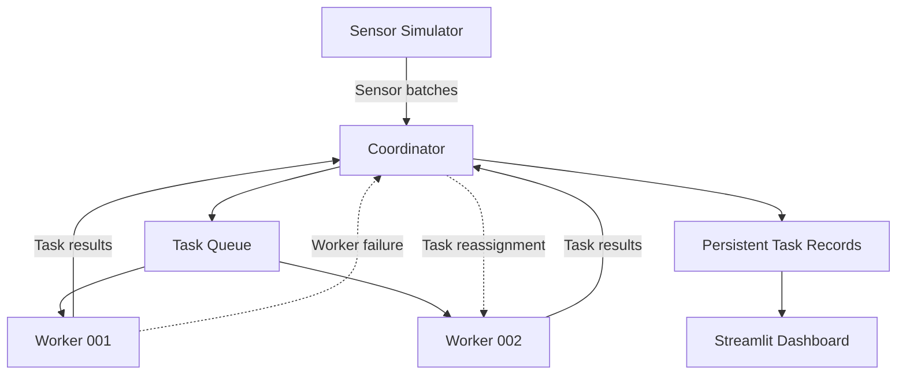

# Distributed IoT Sensor Analytics

A Python-based distributed processing system that simulates IoT sensor data and distributes analytics tasks across multiple worker processes using a central coordinator.

The project demonstrates core distributed systems concepts, including TCP communication, task scheduling, concurrent execution, worker failure detection, task recovery, persistent state management, and performance evaluation.

## Overview

The system simulates sensor readings and distributes analytics tasks across independently running worker processes.

A central coordinator manages incoming tasks, assigns them to available workers, tracks execution status, handles worker disconnections, and collects completed results.

A Streamlit dashboard provides a read-only view of worker status, task progress, and benchmark results.

## Architecture



### Main Components

| Component | Responsibility |
|---|---|
| Sensor Simulator | Generates simulated sensor readings and submits batches. |
| Coordinator | Manages worker connections, task scheduling, execution state, results and recovery. |
| Workers | Execute assigned temperature statistics and anomaly detection tasks. |
| Streamlit Dashboard | Displays worker status, task progress and benchmark information. |

## Key Features

- **Distributed task execution:** Multiple worker processes execute independent analytics tasks concurrently.
- **TCP communication:** Workers and coordinator exchange JSON messages using four-byte length-prefixed framing.
- **Task scheduling:** Pending tasks are assigned to registered and available workers.
- **Worker failure handling:** Unfinished tasks are returned to the pending queue when a worker disconnects.
- **Recovery:** Persisted unfinished tasks can be recovered following coordinator restart.
- **Task tracking:** Task records maintain execution status, worker assignment, results and execution duration.
- **Performance benchmarking:** Compares execution time and throughput between one-worker and two-worker configurations.
- **Live monitoring:** A Streamlit dashboard displays operational state and benchmark results.

## Analytics Operations

Each sensor batch generates two independent tasks:

**1. Temperature Statistics**

Calculates:
- Number of readings
- Minimum temperature
- Maximum temperature
- Average temperature

**2. Anomaly Detection**

Identifies readings meeting either of the configured thresholds:

- Temperature ≥ 40
- Humidity ≥ 90

## Performance Evaluation

A controlled experiment compared one-worker and two-worker execution using 20 analytics tasks and an artificial processing delay of approximately one second per task.

| Metric | One Worker | Two Workers |
|---|---:|---:|
| Tasks completed | 20 | 20 |
| Execution time | 20.242 s | 10.112 s |
| Throughput | 0.988 tasks/s | 1.978 tasks/s |
| Average task duration | 1.0068 s | 1.0079 s |

The two-worker configuration achieved approximately **2.00× speedup** under the tested workload.

The artificial delay makes concurrent execution easier to measure. These results should not be interpreted as a 2× improvement in the underlying analytics calculations alone.

## Technologies Used

- Python
- TCP sockets
- JSON
- Struct-based message framing
- Selectors for coordinator-side network event handling
- Streamlit for dashboard visualisation
- File-based JSON persistence

## Project Structure

```text
distributed-iot-sensor-analytics/
│
├── coordinator.py
├── worker.py
├── sensor_simulator.py
├── dashboard.py
│
├── task_record.json
├── worker_state.json
├── benchmark_summary.json
│
├── README.md
│
├── docs/
│   └── project_documentation.pdf
│
└── screenshots/
    ├── two_worker_execution.png
    ├── worker_failure.png
    ├── task_reassignment.png
    ├── successful_completion.png
    └── benchmark_results.png
```

The JSON files are runtime state and benchmark artefacts; their exact presence depends on the current execution and persistence configuration.

## Running the Project

### Prerequisites

- Python 3
- Streamlit (for the dashboard)

### 1. Start the Coordinator

Open a terminal in the project directory:

```bash
python coordinator.py
```

### 2. Start the Workers

Open separate terminals and start the workers:

```bash
python worker.py
```

For a second worker, use the configured second-worker instance with its own worker identifier.

### 3. Start the Sensor Simulator

In another terminal:

```bash
python sensor_simulator.py
```

The simulator generates sensor batches and submits them to the coordinator.

### 4. Open the Dashboard

Run:

```bash
streamlit run dashboard.py
```

The dashboard displays worker availability, task execution progress, completed tasks and benchmark information.

## Reliability Testing

The project was tested under worker disconnection and coordinator restart scenarios.

The worker-disconnection experiment demonstrated that the coordinator could detect a disconnected worker, return its unfinished task to the pending queue, and reassign the task to another available worker.

A separate startup test demonstrated recovery of persisted unfinished work following coordinator restart.

## Limitations

- The implementation is tested in a local environment using independent worker processes.
- The performance benchmark uses an artificial processing delay.
- The benchmark uses a relatively small workload of 20 tasks.
- The dashboard is read-only and intended for local monitoring.
- The project does not claim production-scale performance or multi-machine deployment.

## Project Documentation

The accompanying technical report contains detailed explanations of the system architecture, communication protocol, task lifecycle, reliability testing, performance evaluation, limitations and supporting screenshots.

See `docs/project_documentation.pdf`.

## Purpose

This project was developed to explore practical distributed systems concepts through the implementation of a working coordinator–worker architecture for simulated IoT sensor analytics.
